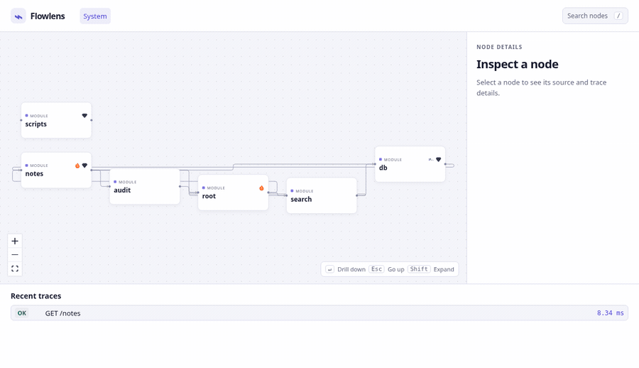

# Flowlens



Flowlens is a local development tool for TypeScript and JavaScript backends. It draws a graph of your modules, HTTP routes, steps, and functions. Live OpenTelemetry traces show which code ran, how long each step took, and where requests failed.

## Quick start

Use Node 22.18 or newer and pnpm 10. If Corepack is unavailable, install pnpm 10 and run the same commands without the `corepack` prefix.

```sh
git clone https://github.com/nahomkasa999/Graph-ai.git
cd Graph-ai
corepack pnpm install --frozen-lockfile && corepack pnpm build
corepack pnpm demo
# Open http://127.0.0.1:4777
```

To see live traces, run `corepack pnpm demo:traced` in a second terminal, then `corepack pnpm demo:traffic` in a third. Set `DEMO_LATENCY=1` for the traced app to make the index and audit steps easier to see.

Double-click a node to drill down. Shift-click expands it in place. Use the breadcrumb to go up, `/` to search, and the recent trace list to replay a request. Node icons identify detected technologies such as Pinecone, SQLite, PostgreSQL, and Redis.

## Use it on your project

After building this workspace, run the CLI against the directory containing your `tsconfig.json`.

```sh
node packages/cli/dist/index.js init /path/to/project
node packages/cli/dist/index.js analyze /path/to/project
node packages/cli/dist/index.js dev /path/to/project --entry src/index.ts
```

Run the traced start command printed by `dev` in a separate terminal. The viewer and OTLP receiver use the same loopback server. Analysis writes `.flowlens/graph.json` and `.flowlens/instrument.json`. Source changes refresh the graph in the viewer. Restart the traced app after adding or renaming an instrumented function so its loader reads the new manifest.

## v1 limitations

- Static analysis supports Hono and Express route registrations with literal paths and one level of router mounts. Handler steps come from top-level statements. Class methods, nested callbacks, and dynamic routes are outside the v1 analysis scope.
- Runtime tracing supports native Node ESM with TypeScript or JavaScript. The `tsx` runner and CommonJS apps are outside the v1 runtime scope.
- A step that only calls an external package has no function span and displays no duration.
- Traces and rolling stats stay in memory until the local server stops. The viewer binds to `127.0.0.1`.

The technical spec, architecture decisions and milestone status are in [docs/SPEC.md](docs/SPEC.md), [DECISIONS.md](DECISIONS.md) and [PROGRESS.md](PROGRESS.md).

Flowlens source is MIT licensed. The viewer uses [ELK.js](https://github.com/kieler/elkjs) for layered layout and ships its upstream worker as a local asset.
